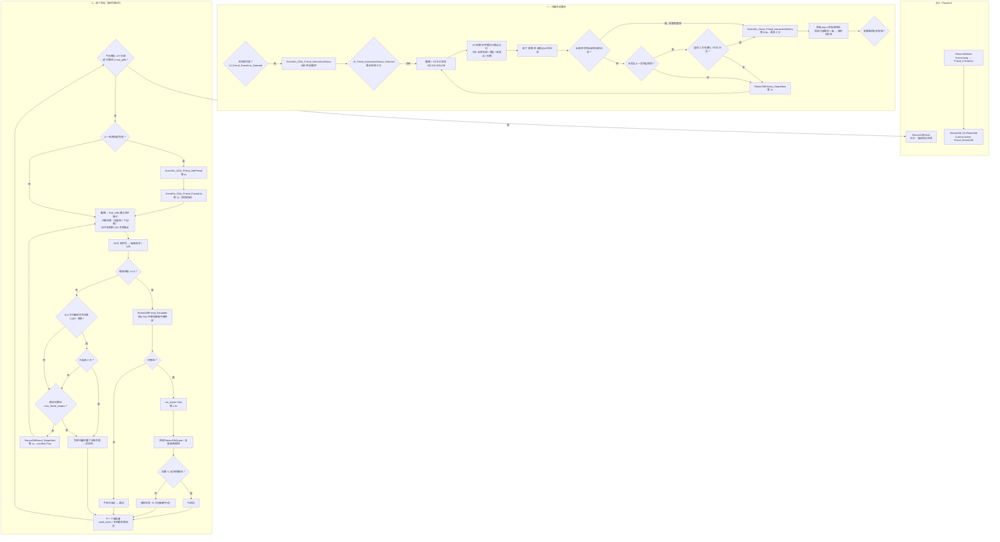

# 自动回礼管理器

Custom Action：`Friend_ReturnGift`

文件：`agent/custom/action/friend.py`

依赖节点：`assets/resource/pipeline/Friend/ReturnGift.json`、`assets/resource/pipeline/Scene/UI/Friend.json`、`assets/resource/pipeline/Scene/Do/Friend.json`、`assets/resource/pipeline/Scene/Do/Common.json`

## 功能概述

扫描好友「互动履历」，筛出**目标游戏日**里「获赠」的友情点不为 0 的记录，再按时间先后回到好友列表逐个把友情点送回去。

- 数据来源是互动履历的**记录列表**：动作自己 OCR 记录区并按行拼接 玩家名称 / 类型 / 友情点 / 日期，滚动的动作、进出互动履历的动作仍交给 pipeline 节点；
- 时间判定按**游戏日**（北京时间 05:00 切换），目标日由调用方通过 `attach` 的 `day` 传入（`0` = 当天、`1` = 昨天……）；
- 好友定位靠**名片格子**：以头像白框为锚点切格，再用格子里的昵称做模糊匹配；
- 能不能赠送交给 `ReturnGiftFriend_Sendable` 节点（与 `SendGiftDo` 同判据），动作只负责把该节点的 ROI 平移到当前格子上。

## 快速使用

```jsonc
{
    "ReturnGift_Do:ReturnGift": {
        "action": {
            "type": "Custom",
            "param": {
                "custom_action": "Friend_ReturnGift"
            }
        },
        "attach": {
            "day": 1
        }
    }
}
```

调用前需先处于好友列表（`ReturnGiftMain` 里用 `SceneJump` 跳 `Friend_FriendList`）。

参数推荐写在节点 `attach`：`pipeline_override` 对 `attach` 按顶层键合并，选项 case 之间不会互相覆盖；`custom_action_param` 作为兼容回退，两边都有时 `attach` 优先。

### 参数

| 参数 | 默认 | 说明 |
| --- | --- | --- |
| `day` | `1` | 目标游戏日偏移（`0` 当天、`1` 昨天……） |
| `dry_run` | `false` | 只扫描不赠送 |
| `max_gifts` | 每日上限 | 最多赠送几次 |
| `max_history_scrolls` | `25` | 互动履历最多滚动几次 |
| `max_friend_swipes` | `30` | 找一个好友时最多滑动几次好友列表 |
| `settle_interval` | `0.8` | 页面操作后的等待（秒） |
| `swipe_delay` | `1.0` | 滑动后的等待（秒） |
| `*_node` | 见下表 | 覆盖各步骤使用的节点名 |
| `geometry` | 见下表 | 覆盖格子几何参数（字符串会被转成对应类型） |

可覆盖的节点名：`history_open_node`（默认 `SceneDo_Click_Friend_InteractionHistory`）、
`history_close_node`（`SceneDo_Close_Friend_InteractionHistory`）、
`history_selected_node`（`UI_Friend_InteractionHistory_Selected`）、
`history_swipe_node`（`ReturnGiftHistory_SwipeNext`）、
`friend_swipe_node`（`ReturnGiftFriend_SwipeNext`）、
`sendable_node`（`ReturnGiftFriend_Sendable`）、
`quota_node`（`ReturnGiftQuota`）、
`add_friend_node`（`SceneDo_Click_Friend_AddFriend`）、
`friend_list_node`（`SceneDo_Click_Friend_FriendList`）、
`friend_list_selected_node`（`UI_Friend_FriendList_Selected`）。

## 名片格子

格子大小同 `assets/resource/image/0.png`：**1077x131**。锚点是头像白框（`[32,1,131,131]` 附近是头像），白框是 124x124 的圆角白边，其左上角被等级数字压住，但**右竖线**与**下边框**始终存在：

| 字段 | 默认 | 说明 |
| --- | --- | --- |
| `cell_left` / `cell_w` / `cell_h` | `19` / `1077` / `131` | 格子左沿（列表左边界）与尺寸 |
| `list_top` / `list_bottom` | `110` / `690` | 列表可视区，越界的半格不参与识别 |
| `frame_*` | `124` / `158` / `4` / `127` | 白框尺寸、右竖线相对格子左边的偏移、上沿/下沿偏移 |
| `frame_scan_w` / `frame_min_run` | `200` / `100` | 白框搜索宽度、竖线最短像素长度 |
| `white_min` | `220` | 近白阈值（RGB 三通道） |
| `name_roi` / `uid_roi` | `[185,4,185,31]` / `[185,32,185,26]` | 昵称、UID 区域 |
| `uid_center_offset` | `45` | 无白框时用 UID 文字中心反推格子 |
| `gift_roi` | `[960,18,112,108]` | 格子里「赠送」按钮的识别区域 |

算法：

1. 逐列找长度 ≥ `frame_min_run` 的连续近白竖线，相邻列合并成边线；
2. 同一条边线上不同 y 段对应不同格子，按 y 范围分组；
3. `x0 = 右竖线 x - 158`、`y0 = 白框上沿 - 4`；顶端被裁掉时改用 `白框下沿 - 127`；
4. 校验下边框存在且「赠送」按钮完整落在可视区（半格会被跳过，滑动后会再出现）。

白框不可用（名片皮肤不是白色）时退化为 **UID 文字锚点**：`y0 = UID 文字中心 - 45`。

## 昵称匹配

互动履历里的名字与好友列表里的名字可能被截断或 OCR 有出入，因此按分数匹配：

| 情况 | 分数 |
| --- | --- |
| 完全一致 | `1.0` |
| 一方是另一方的前缀（截断） | `0.9` |
| 一方是另一方的后缀 | `0.85` |
| 一方包含另一方（长度 ≥ 2） | `0.75` |
| `difflib` 相似度 ≥ 0.8 | `0.7` |

低于 `0.6` 不视为目标好友，但会把最接近的候选与分数打进日志。单字名只认完全一致，避免误送。

## ROI 覆盖的做法

`ReturnGiftFriend_Sendable` 节点自身的两个 `roi` 覆盖整列赠送按钮；赠送时动作读取该节点的解析后数据（`context.get_node_data`），递归把其中的 `roi` 全部换成「当前格子内的赠送按钮区域」，再用这份 override 先 `run_recognition` 判断是否可赠送、命中后 `run_action` 点击。

好处是**节点定义仍是唯一来源**（模板、颜色区间、连通域参数都写在 pipeline 里），代码只做平移，不复制识别参数。

## 流程图


