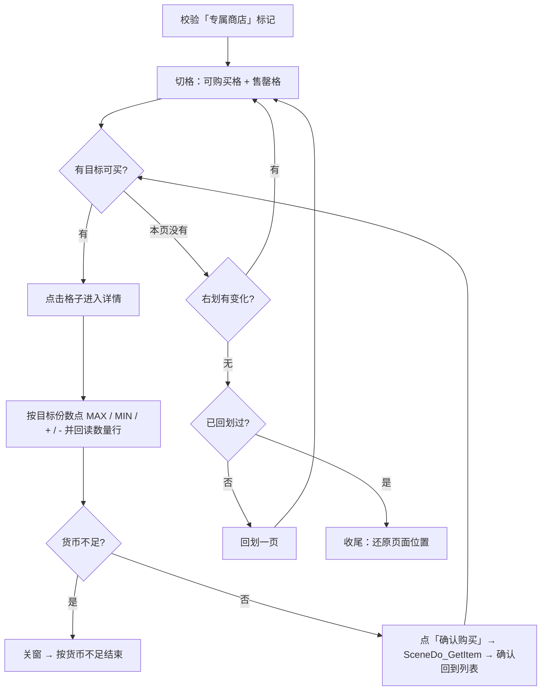

# 高账商店购物管理器

Custom Action：`Shop_VIP_Manager`

文件：`agent/custom/action/vip_shop.py`

依赖场景节点：`assets/resource/pipeline/Scene/UI/Shop.json`、`assets/resource/pipeline/Scene/Do/Shop.json`、`assets/resource/pipeline/Scene/Do/Common.json`

## 功能概述

用于在高账商店（专属商店）里按**商品名**购买指定商品。

前置条件：已经停留在高账商店的商品页面（没有商品详情弹窗）。动作自身会先复查「专属商店」标记，必要时关闭残留弹窗。

与「耀斑商店购物」（`Shop_Activity_1_Manager`）不同，高账商店的商品分免费/收费两类，玩家通常只买其中一部分，因此：

- **选择维度是商品名**，商品清单由调用方通过节点 `attach` 传入（多选时每个选项 case 写一个键即可叠加）；
- **不做“买全部”**：一件商品都没指定时直接失败退出，避免在收费商品（消耗**打口磁带**）上误花钱；
- 售罄、货币不足、数量加减、关闭详情、获得物品弹窗、翻页都由 pipeline 节点完成，动作只负责“点哪个、点几次、结果如何”。

## 快速使用

在 pipeline 中调用：

```jsonc
{
    "Shop_Buy": {
        "action": {
            "type": "Custom",
            "param": {
                "custom_action": "Shop_VIP_Manager"
            }
        },
        "attach": {
            "军用单兵口粮": "MAX",
            "淡海糖果": 1
        }
    }
}
```

调用前需先导航到高账商店（例如用 `SceneJump` 跳转 `VIP_Shop`）。

参数推荐写在节点 `attach` 而不是 `custom_action_param`：`pipeline_override` 对 `attach` 是**按顶层键合并**的，所以每个选项 case 各写一个商品键就能叠加勾选结果；嵌套对象则会被后写的整体替换，因此不要把所有商品塞进同一个 `buy` 映射里。

### 参数

| 参数 | 默认 | 说明 |
| --- | --- | --- |
| `<商品名>` | — | `attach` 顶层键，键名即商品名；值为购买方式（见下表） |
| `items` | `[]` | 商品名列表 / 逗号或换行分隔的字符串 / `{"商品名": true}` 映射，与上一条等价 |
| `buy` | `{}` | 与 `items` 等价的映射形式，只在同一份参数里一次性给出多个商品时使用 |
| `max_quantity` | `true` | 未指定份数的商品默认买满还是买 1 份 |
| `max_rounds` | `24` | 主循环安全上限 |
| `search_roi` | `[315, 175, 930, 440]` | 商品格子搜索区域 |
| `qty_roi` | `[530, 290, 580, 110]` | 「购买数量」标签区域（判断详情页是否打开） |
| `qty_count_roi` | `[561, 353, 511, 47]` | 数量行（`MIN - 1/N + MAX`）识别区域 |
| `confirm_roi` | `[890, 500, 210, 70]` | 「确认购买」按钮区域 |
| `marker_roi` | `[340, 110, 200, 50]` | 「专属商店」页面标记区域 |
| `max_node` / `plus_node` / `minus_node` / `min_node` | `SceneDo_Shop_Detail_Click_Max` / `_Plus` / `_Minus` / `_Min` | 覆盖数量控制节点名 |
| `sold_node` / `money_node` / `close_node` / `get_item_node` | `UI_Shop_Sold` / `UI_Shop_Confirm:Money` / `SceneDo_Shop_CloseInfo` / `SceneDo_GetItem` | 覆盖售罄、货币、关窗、获得物品节点名 |
| `swipe_next_node` / `swipe_last_node` | `SceneDo_Shop_Swipe_Next` / `_Last` | 覆盖翻页节点名 |

购买方式的取值语义：

| 值 | 行为 |
| --- | --- |
| `"MAX"` / `"max"` | 点 MAX 买满，并回读数量行确认到上限 |
| `1` | 只买 1 份（页面默认值；回读确认是 1 就不点按钮） |
| `2`、`3`… | 买 N 份：按 `当前/上限` 决定点 `+` 还是 `-`，超过可买上限时按上限买 |
| `true` | 购买，买多少沿用 `max_quantity` |
| `0` / `false` | 不买 |
| `{"quantity": 2}` / `{"max_quantity": false}` | 单件参数对象，可扩展其它单件配置 |

## 按格切格

商品格子不用“整行灰像素统计 + 行带分组”，而是**按格识别**。原因是售罄卡与正常卡的名称栏样式不同：一页只剩 1~3 列可购买时，整行统计会把名称栏行带切碎，最终一格都切不出来。

1. **定列**：搜索区内每列存在长度 ≥ `MIN_V_RUN`(40) 的连续灰 run（`[44,53]`）即视为竖线，相邻列合并成线段；相邻两条竖线起点相差约 `LEFT_RIGHT_DIST`(187) 才配成一列，`x0 = 左线起点 - 1`。只认成对的竖线，单条竖线做“左/右边界”猜测会生成覆盖到相邻格名称栏的错位窗口。
2. **定名称栏（逐格）**：在该列 192 px 宽内逐行统计灰像素，取占比 ≥ `SOLID_RATIO`(85%) 的“实心行段”；相邻两段（间隙 ≤ `NAME_BAR_EDGE_GAP`(25) 行、总高 15–40 行）即名称栏，`y0 = 上段起点 - 1`。名称栏上下沿是实心深灰、中间是浅灰底 + 白字、格身是彩色美术，所以单格也能稳定切出。
3. **校验**：`y0 + BOTTOM_BORDER_Y`(203) 处必须有灰横条（挡掉“上一格底边框 + 下一格上沿”凑出的伪段），且格子完整落在 `search_roi` 内。
4. **售罄格单独建立**：不由特征切格，而是把 `UI_Shop_Sold` 的识别框反推成格框（`x0 = box.x`、`y0 = box.y - 66`），与可购买格一起进入格子列表并标记 `sold`。售罄卡的名称栏不是深灰，靠这一步才不会“看不见”。

商品名只用于决定“这个格子里是什么”：OCR 一次商品区，把落在各格子名称栏内的文字分配给对应格子；匹配时归一化后做模糊打分（完全一致 > 前后缀截断 > 包含 > 公共前缀），售罄格扣分。

## 工作流程



## 结果判定

| 情况 | 结果 |
| --- | --- |
| 货币不足 | 成功（已买到的保留） |
| 所有目标已购买 / 已售罄 | 成功 |
| 有目标未买到 | 失败，日志列出未购买到的商品名 |
| 同一商品连续失败 `MAX_ITEM_FAILURES`(2) 次 | 失败 |
| 购买后界面状态无法判定（`BUY_UNKNOWN`） | 按“已处理”对待，不重试，避免重复购买 |

## 容错与兜底

| 兜底 | 阈值 | 触发结果 |
| --- | --- | --- |
| 主循环轮数 | `max_rounds`（24） | 停止购买，按已处理结果收尾 |
| 前翻页数 | `MAX_PAGES - 1`（4） | 不再右划 |
| 回划兜底 | 仅一次 | 覆盖“首列被裁、划一下才露出”的画面，之后不再反复摆动 |
| 数量调整轮数 | `QTY_MAX_ROUNDS`（12） | 放弃该商品（买满/1 份且在读不到数量行时按默认继续） |
| 同一商品失败次数 | `MAX_ITEM_FAILURES`（2） | 放弃该商品 |

数量行读不到时不会盲点：`"MAX"` 仍点一次 MAX（幂等）、`1` 份按页面默认继续、要求 N>1 份则放弃该商品。

## 已知限制

- 被屏幕裁掉一部分的列不参与购买（`search_roi` + 完整展示校验），需要划一下让整格露出；动作会先右划、翻不动再回划一次。
- 售罄标识若超出 `UI_Shop_Sold` 的 ROI 或屏幕边界，匹配不到；此时该列的商品既不可购买也不会被标为售罄。
- 数量只支持“页面默认值 / MAX / MIN / 逐次 ±”，无法精确跳到任意份数。
- 商品名必须与游戏内文案一致（模糊匹配可容忍少量截断，但文案变化后需要同步更新调用方的键名）。

## 维护重点

- 商店卡片尺寸/间距变化时，需要同步 `CELL_W`、`CELL_H`、`LEFT_RIGHT_DIST`、`BOTTOM_BORDER_Y`、`SOLD_TEMPLATE_DY`，以及 `SceneDo_Shop_Detail_Click_*`、`UI_Shop_Sold` 的模板 ROI。
- 数量、关窗、翻页、售罄、货币节点都集中在类常量里定义，改名时优先用 `attach` 覆盖（`*_node` 参数），不要散落修改。
- 新增购买方式（例如按份数上限）时，扩展 `_parse_item_spec` / `_resolve_quantity` 即可，切格与点击逻辑无需改动。