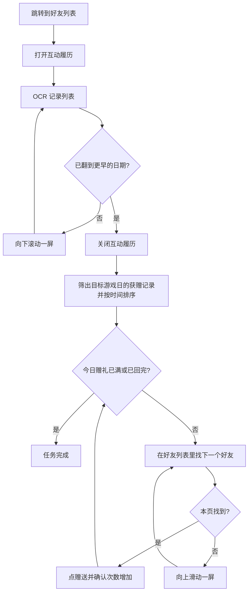

# 自动回礼

自动查看好友「互动履历」，找出今天给你送过友情点的人，按时间先后把友情点回赠回去，直到今日赠礼达到上限或全部回礼完毕。

---

## 这个功能会做什么？

当你使用「自动回礼」功能时，MAK 会自动：

1. 从当前界面跳转到**好友列表**
2. 打开**互动履历**，把记录列表翻一遍
3. 筛出「获赠」、友情点不为 `0`、且日期落在**目标游戏日**的记录
4. 按时间先后回到好友列表，逐个找到这些好友并赠送
5. 每次赠送后确认今日赠礼进度，达到上限（如 `20/20`）就收尾

同一个好友给你送了多次，只会回一次礼；今天的赠礼额度用完后，剩余好友不再赠送。

---

## 如何配置？

| 设置项 | 说明 |
| ------ | ---- |
| 回礼日期 | 要给哪一天的记录回礼：当天 / 昨天 / 前天……直到 6 天前。默认**昨天** |

::: tip 关于「游戏日」
日期按**游戏日**计算，而游戏日在北京时间**凌晨 5 点**更新：例如 `11-07 02:46` 的记录算作 `11-06`。所以凌晨 2 点还在玩的话，选「当天」指的是从凌晨 0 点算起的新一天，而不是刚才那个「昨天」。
:::

任务分组为「日常」与「好友」，仅支持 **ADB 控制器**。

---

## 运行流程

---

## 注意事项

- 需要游戏已解锁**好友功能**；未解锁时跳转会失败。
- 运行过程中**不要操作模拟器**，否则滑动与点击位置会错乱。
- 好友如果今天已经送过，按钮是灰色的，MAK 会跳过，不会重复点击。
- 「获赠 0」的记录不会回礼：对方没有送成功或送的是 0 点。
- 好友太多时，MAK 会反复上下翻好友列表找人；翻到底（连续两次滑动好友没有变化）就换下一个好友，并从列表顶部重新开始找。
- 回礼完成后不会关闭游戏内的任何页面，结束时停留在好友列表。
