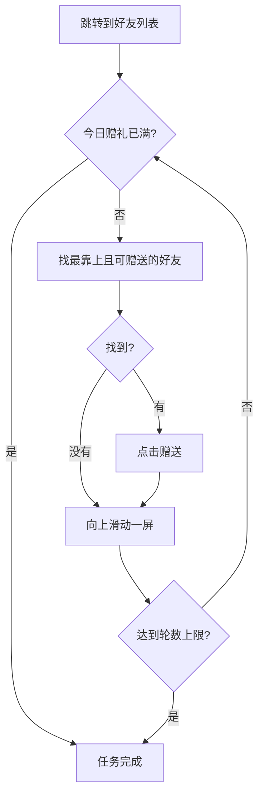

# 赠送礼物

自动前往「好友列表」，给好友逐个赠送礼物，直到今日赠礼达到上限。

---

## 这个功能会做什么？

当你使用「赠送礼物」功能时，MAK 会自动：

1. 从当前界面跳转到**好友列表**
2. 在当前这一屏里找到**最靠上、且当前可赠送**的好友，点一次赠送
3. 往上滑动一屏，继续找下一个可赠送的好友
4. 每轮检查今日赠礼进度，达到上限（如 `20/20`）就收尾

已经赠送过的好友，按钮会变成灰色，MAK 会自动跳过，不会重复点击。

---

## 如何配置？

该功能**没有额外设置项**，添加任务后直接运行即可。

| 设置项 | 说明 |
| ------- | ------ |
| 无 | 任务自身不需要配置；赠送顺序由界面从上到下决定，想调整顺序请在游戏内自行排序好友 |

任务分组为「日常」与「好友」，仅支持 **ADB 控制器**。

---

## 运行流程

---

## 注意事项

- 需要游戏已解锁**好友功能**；未解锁时跳转会失败。
- 运行过程中**不要操作模拟器**，否则滑动与点击位置会错乱。
- 若好友列表为空，任务会在滑动几屏后自行结束，不会报错。
- 赠送过程中若出现二次确认等弹窗，请提交 Issue 或直接关闭后重试。
