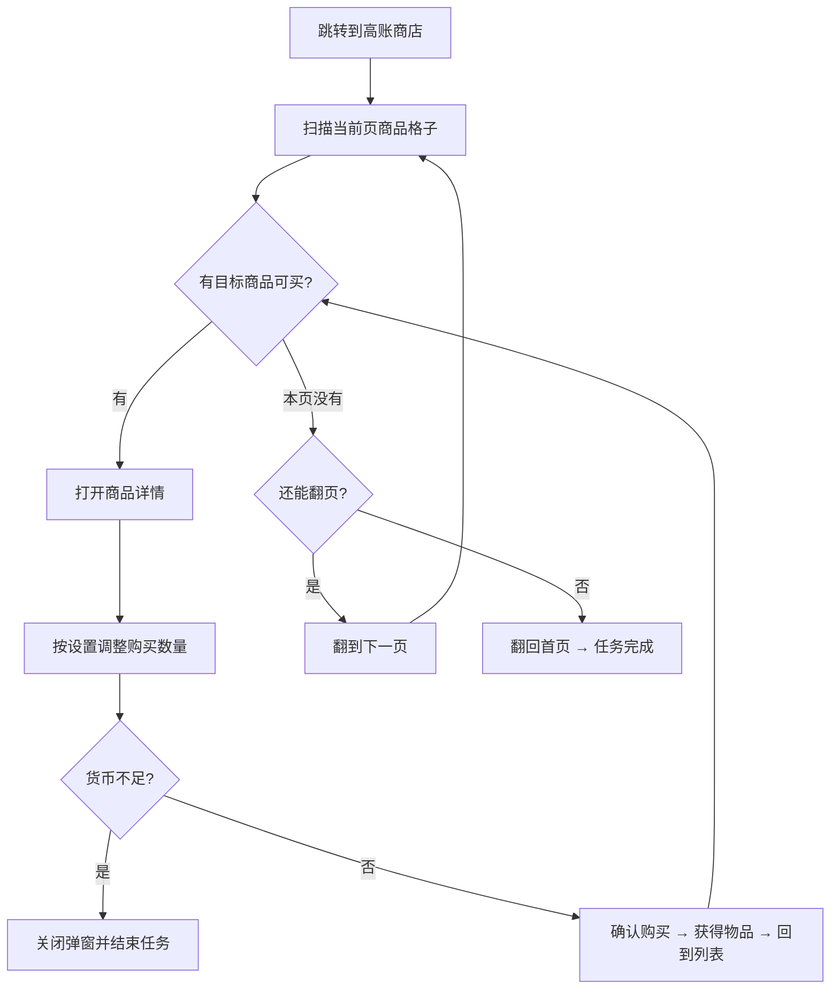

# 自动购物

自动前往「高账商店」，并逐个购买选择的商品。

---

## 这个功能会做什么？

当你使用「自动购物」功能时，MAK 会自动：

1. 从当前界面跳转到**高账商店**
2. 扫描当前页面的商品格子
3. 逐个购买选择的商品

购买过程中如果遇到**货币不足**，会自动停下并结束任务；**已售罄**的商品会跳过。

::: caution 注意
不得在没有高级账号的情况下使用该功能！
:::

---

## 如何配置？

商品分成「免费物品」和「收费物品」两组，每组都有一个「全选」开关：

| 设置项 | 说明 |
| ------- | ------ |
| **免费物品全选** | 默认**开启**。开启＝把商店里所有免费物品都买一遍；关闭后可以在「免费物品」里逐项勾选 |
| **免费物品** | 可多选，仅在「免费物品全选」关闭时出现 |
| **收费物品全选** | 默认**关闭**。开启＝把商店里所有收费物品都买一遍（会消耗货币） |
| **收费物品** | 可多选，仅在「收费物品全选」关闭时出现 |

---

## 当前支持的商品

| 免费商品 | 收费商品 |
| ------ | ------ |
| 军用单兵口粮 | 定期发射计划 |
| 淡海糖果 | 高级考核材料组合包 |
| 第二版能元 | 中级考核材料组合包 |
| 训练用器材 | 低级考核材料组合包 |
| 载具研发公式 | 技能升级材料组合包 |

---

## 运行流程

---

## 注意事项

- 请确保游戏**已开通高级账号（VIP）**
- 运行过程中**不要操作模拟器**
- 收费商品会消耗打口磁带，第一次使用建议先只勾选一件，确认消耗符合预期
- 商品名称由游戏内文案决定，若某次更新后名称变化导致某件商品一直买不到，可回到任务配置里对应调整
